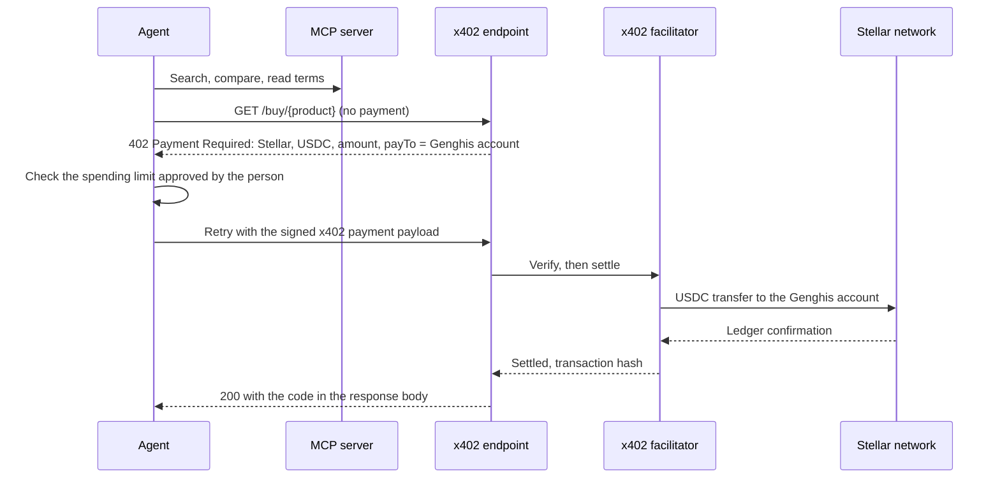

# Genghis on Stellar: technical architecture

Version 2, 20 October 2026. Replaces version 1 (September 2026), which used XLM as the default asset and a memo bridge for agents. Scope: a USDC-first Stellar checkout for people and an x402 payment path for AI agents, on top of a marketplace that is already live. Everything below is what we will build under the award, and how each piece connects to existing Stellar building blocks.

Testnet demo of the checkout: https://genghisecommerce.github.io/genghis-stellar-poc/

## 1. Asset strategy

One rule across the checkout, the agent path and this document: **USDC is the primary asset, XLM is the secondary option.**

| | USDC (primary) | XLM (secondary) |
|---|---|---|
| Who receives it | A Genghis Stellar account | Our current payment processor, as today for other assets |
| Why | Products are priced in dollars. A stable asset keeps the amount fixed from quote to settlement, fits agent spending limits, and keeps reconciliation, refunds and margins simple | Native asset, held by most Stellar wallets |
| Attribution | People: text memo carrying the order reference. Agents: the x402 payment is bound to the HTTP request that asked for it | Text memo issued by the processor on its shared deposit address |
| Rate risk | None: 1 USDC = 1 USD of price | The processor quotes the XLM amount and carries the rate from quote to settlement; the quote expires and the transaction expires with it |
| Refund path | USDC back to the paying Stellar account, from the Genghis account | Through the processor, as today |

Why USDC does not go through the processor: our processor does not support USDC on Stellar (confirmed with them in September 2026; partner-only, possibly later). Receiving USDC on our own account also removes the attribution problem that version 1 worked around: a standard x402 payment can now settle directly to Genghis.

## 2. What exists and what we add

| Component | Status | Change under this award |
|---|---|---|
| Storefront (Angular, server-side rendered) | Live | Stellar Wallets Kit in the checkout, USDC shown first |
| Order system (NestJS) and order state machine | Live | Stellar payment path, payment listener, synchronous delivery |
| Catalogue and pricing service | Live | None |
| Read-only MCP server for agents | Built and tested against production | None; agents keep discovering products through it |
| Payment processor integration | Live for other assets | XLM on Stellar added |
| Genghis USDC receiving account on Stellar | Testnet only (demo) | Mainnet account, monitored, with sanctions screening before delivery |
| x402 endpoint for agents | Not built | New: standard x402 on Stellar, USDC to the Genghis account |

## 3. Flow A: a person pays with USDC from a wallet

```mermaid
sequenceDiagram
    participant B as Buyer (browser)
    participant S as Storefront
    participant O as Order system
    participant N as Stellar network
    B->>S: Checkout, USDC selected by default
    S->>O: Create order (price recomputed server side)
    O-->>S: Payment request: Genghis account, USDC amount, order memo, expiry
    S->>B: Wallets Kit: connect Freighter, xBull, Albedo or another kit wallet
    B->>N: Signed classic Payment of USDC with the order memo
    O->>N: Listener sees the payment to the Genghis account
    O->>O: Match memo, asset, issuer and amount; screen the sender
    O->>O: Order state machine: paid, then fulfilled
    O-->>B: Code in the response
```

Stellar details:
- Asset: USDC issued by Circle on Stellar. The receiving account holds a USDC trustline.
- Transaction: one classic Payment operation to the Genghis account, MEMO_TEXT set to the order reference, time bounds set to the order expiry, standard base fee.
- Buyer holds XLM but no USDC: the checkout can offer a path payment (`pathPaymentStrictReceive`) that sends XLM and delivers the exact USDC amount through the Stellar DEX. The demo shows this on testnet.
- Wallet connection: Stellar Wallets Kit. The kit signs the transaction XDR. We never see keys.
- Client guard: the pay button stays disabled until the order memo is set; a payment without it cannot be attributed.
- Listener: the order system follows payments to the Genghis account (Horizon payment stream, with Stellar RPC `getEvents` on the USDC contract as the second source) and matches each one to an open order before anything is delivered. The demo runs the same match from the browser.

## 4. Flow B: a person pays with XLM

Same checkout, XLM selected. The order system requests an XLM payment from the processor, which returns its shared deposit address, a text memo, the amount and an expiry. The buyer signs a classic Payment with that memo. The processor's confirmed notification releases the order, with an amount check on our side. On mainnet XLM never lands on a Genghis account.

## 5. Flow C: an agent pays through x402



How it works:
- The endpoint follows the x402 exact scheme for Stellar: the payment requirements name the Stellar network, USDC and the Genghis account as `payTo`. The agent signs a USDC token transfer; a facilitator verifies and settles it.
- Attribution needs no memo: the payment payload answers one 402 response for one order, and the endpoint delivers only after the facilitator reports settlement for that payload.
- We integrate an existing Stellar x402 facilitator rather than writing our own. Compatibility with standard Stellar x402 clients is tested on testnet before mainnet; until then this document treats it as a target, not a fact.
- Every request is idempotent. A retried request with the same payment identifier returns the same result and never buys twice.
- Agents pay in USDC only. XLM through the processor is a checkout option for people.

## 6. Order state machine and failure cases

States: created, awaiting payment, payment seen, paid, fulfilled, expired, failed, refund due.

| Case | Behaviour |
|---|---|
| USDC payment without a memo, or with an unknown memo | Not delivered. Held for manual reconciliation; refunded to the sending account if no order matches. |
| Underpayment | Order stays open until expiry, then moves to refund due. |
| Overpayment | Order is fulfilled and the difference is refunded. |
| Wrong asset or issuer on the Genghis account | Not delivered, refunded. |
| Sender fails sanctions screening | Not delivered; handled under our AML procedure. |
| Delivery fails after settlement | Order moves to refund due; the agent receives the failure in the response. |
| Duplicate request or submission | Idempotency key returns the first result. |
| Expired XLM quote | New quote and a new memo. An old memo is never reused. |

## 7. Guardrails

- The server sets the price. A client cannot propose what it pays.
- Every agent purchase has a per-order cap and a per-session cap, enforced on the server. A request over the cap is refused, not trimmed.
- A payment that cannot be tied to an order is never delivered against.
- Our existing anti-money-laundering purchase limits apply to Stellar orders, for people and agents.
- USDC senders are screened against sanctions lists before delivery.
- The purchase path is a separate component with its own credentials. The read-only MCP server holds no credentials and refuses writes.
- The receiving account's signing key is kept off the web servers; the listener only reads.

## 8. Environments

- Testnet: Circle's testnet USDC and a Genghis testnet receiving account (live in the demo). The processor has no Stellar testnet, so the XLM processor path uses a stub with the processor's fields.
- Staging: the same code on our staging environment against testnet.
- Mainnet: USDC on the Genghis account, XLM through the processor.

## 9. Which parts integrate Stellar building blocks

| Part | Stellar building block | Our own work |
|---|---|---|
| Checkout wallet connection | Stellar Wallets Kit | Checkout screens |
| USDC payment and path payment | Classic Payment, `pathPaymentStrictReceive`, Circle USDC | Order memo issuance |
| Listener | Horizon payment stream, Stellar RPC `getEvents` | Matching and state machine |
| Agent payments | x402 exact scheme for Stellar, existing facilitator | Endpoint, caps, idempotency |
| Agent discovery | None (our MCP server) | Already built |

## 10. Open technical points

- Which Stellar x402 facilitator we run against on mainnet, and its fees and limits.
- The processor's notification delay for XLM on Stellar is unmeasured; we measure it before we publish any speed claim for the XLM option.
- Treasury handling of USDC received on the Genghis account (conversion schedule) is set by our finance policy, outside this build.

## References

- Testnet demo: https://genghisecommerce.github.io/genghis-stellar-poc/
- Stellar Wallets Kit: https://stellarwalletskit.dev/
- x402 on Stellar: https://developers.stellar.org/docs/build/agentic-payments/x402/quickstart-guide
- x402 specification: https://github.com/x402-foundation/x402
- USDC on Stellar: https://developers.stellar.org/docs/tokens/stellar-asset-contract
