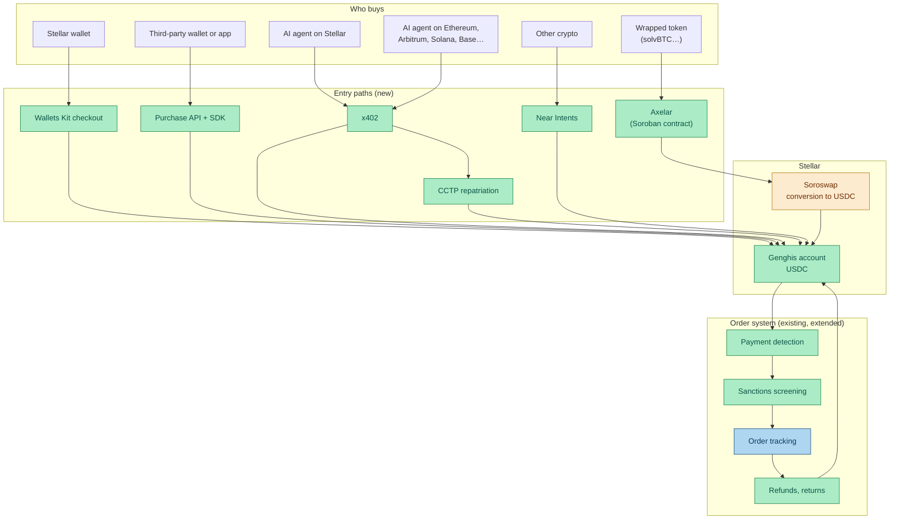
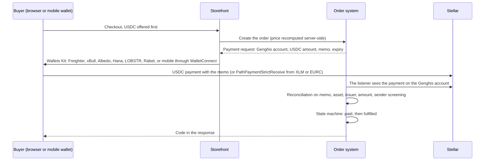
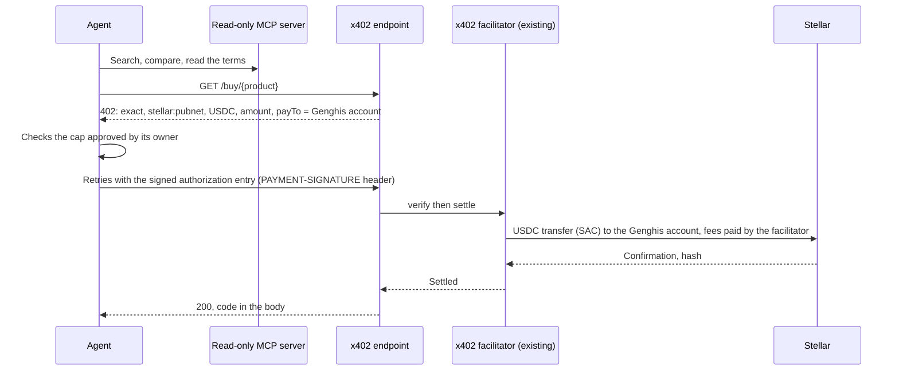
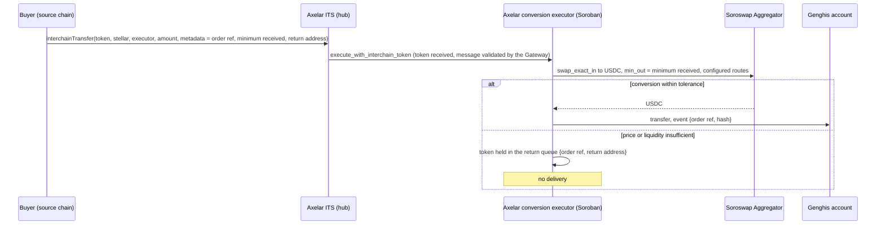

# Genghis on Stellar: technical architecture

Version 3, 9 November 2026. Replaces version 2 (20 October 2026).

Genghis sells digital goods for crypto. With this project, anyone can buy on Genghis from a Stellar wallet or an AI agent, and whatever chain they start from, Genghis settles on a Stellar account, in USDC. An API and an SDK let a wallet or an application embed the catalogue in a few days.

---

## 1. Summary

**Today.** A marketplace live since October 2025: gift cards, eSIMs, mobile top-ups, game keys, 4,500+ products across 86 countries, paid in crypto through a payment processor. AI agents already browse the catalogue through our MCP server; they cannot buy yet.

**What we are building.** A single landing point for every payment: the Genghis Stellar account, in USDC (Circle's digital dollar). A buyer who holds EURC (Circle's digital euro) or XLM pays from it in one transaction that delivers USDC. A wrapped token arriving through Axelar is converted to USDC on arrival by Soroswap, an existing exchange service.

| Who buys | With what | How it works |
|---|---|---|
| A person with a Stellar wallet | USDC, EURC or XLM | They sign on the genghis.pro page or in their wallet; the code arrives a few seconds later |
| A third-party wallet or application | Its users' USDC or EURC | Embeds our catalogue with the Genghis Checkout SDK and the Genghis Purchase API |
| An AI agent on Stellar | USDC | Pays through x402, the open machine-payment protocol, within the limit its owner set |
| An AI agent on Ethereum, Arbitrum, Solana, Base… | That chain's USDC | Pays through x402 on its own chain; Genghis brings the USDC back to Stellar through CCTP, Circle's bridge |
| A person or an agent holding another crypto (BTC, ETH, SOL, USDT…) | That crypto | Near Intents delivers it as USDC on the Genghis account, above its per-chain minimums; below them the current processor stays |
| A holder of a wrapped token with a market on Stellar (today solvBTC) | That token | Axelar transfers it to Stellar, Soroswap converts it on arrival |

## 2. What exists, what is new

| Block | Status |
|---|---|
| Storefront, orders, catalogue, read-only MCP server | In production; orders are extended to Stellar payments |
| Stellar account, wallet checkout, payment detection, instant delivery | Testnet demo; to be built into the live site |
| Purchase API and Checkout SDK for third-party wallets and applications | New |
| Agent payments through x402, on Stellar and on CCTP chains, USDC repatriation | New; our current prototype is a custom XLM and memo 402 flow, which the standard exact scheme replaces |
| Other cryptos through Near Intents, wrapped tokens through Axelar, Soroswap conversion | New |
| Refunds, sanctions screening, monitoring | New |

Integrations from the official list: **Stellar Wallets Kit, CCTP, Near Intents, Axelar, Soroswap.**

## 3. Why Stellar

- **The money arrives whole and fast.** Our margins are a few percent; on Stellar, USDC settles in five seconds for a fraction of a cent, and the order closes in the same response.
- **One settlement account.** Whether the buyer starts from Stellar, Ethereum, Solana or Bitcoin, the money ends up on the same Stellar account. Stellar is the settlement layer, not one more option.
- **The building blocks exist.** Wallets Kit, Circle's USDC and EURC, CCTP, Near Intents, Axelar, Soroswap, x402: we assemble, we do not rewrite.
- **What Stellar gets out of it.** A place where Stellar USDC and EURC turn straight into a top-up, an eSIM or a gift card, from any wallet, with no account and no bank card; machine purchases; USDC flowing into Stellar with every purchase that starts elsewhere.

## 4. Overview

Green: new. Blue: existing, extended. Orange: ecosystem service, called, never rewritten.

**Component detail.** The names below are the ones used in the rest of this document and in the milestones.

| Component | Status | Work in this submission |
|---|---|---|
| Storefront (Angular, server-side rendered) | in production | Stellar Wallets Kit in the checkout, USDC shown first |
| Order system (NestJS) and order state machine | in production | Stellar payment path: payment requests, reconciliation, states and failure paths |
| Catalogue and pricing service | in production | none |
| Read-only MCP server | built, tested against production | none: agents keep discovering products there |
| Payment processor integration | in production for the other assets | XLM enabled as a secondary option (a setting, outside the budget) |
| **Stellar settlement account** | testnet (demo) | mainnet account, USDC trustline, separate read / outgoing keys, monitoring |
| **Stellar Wallets Kit checkout** | testnet demo | in the real checkout: extensions, mobile through WalletConnect, path payment from XLM or EURC to USDC |
| **Payment listener** | demo (browser) | in the order system: Horizon payments stream + RPC `getEvents` on USDC, synchronous delivery |
| **Outgoing payments service** | to build | refunds and returns from a dedicated key, log |
| **Genghis Purchase API** | to build | create an order, get the Stellar payment request, track it, receive the code |
| **Genghis Checkout SDK** | to build | TypeScript: builds the Stellar transaction for the wallet to sign, tracks settlement, returns the code |
| **x402 endpoint for agents** | to build; replaces our custom XLM and memo prototype | exact scheme on Stellar, existing facilitator; same terms on the chains covered by CCTP (Ethereum, Arbitrum, Solana, Base…) |
| **CCTP repatriation service** | to build | burn on each chain where an agent paid, mint on Stellar through `CctpForwarder` to the Genghis account; same service for every chain (EVM adapter, Solana adapter) |
| **Near Intents intake** | to build | 1Click quote, deposit address, tracking, reconciliation by Stellar transaction hash |
| **Axelar conversion executor** | to build | Soroban contract: receives the ITS token, converts it into USDC through Soroswap, deposits it on the Genghis account or queues it for return |
| **Sanctions screening** | to build | sender check before delivery, every path |
| **Monitoring** | to build | alerts on unreconciled payments, listener lag, balances, stuck queues |

---

## 5. The settlement account and the keys

**Stellar settlement account**: a classic `G…` Genghis account on mainnet, with one trustline, to the USDC issued by Circle (`USDC:GA5ZSEJYB37JRC5AVCIA5MOP4RHTM335X2KGX3IHOJAPP5RE34K4KZVN`; SAC contract `CCW67TSZV3SSS2HXMBQ5JFGCKJNXKZM7UQUWUZPUTHXSTZLEO7SJMI75`). Two addresses for one asset: the `G…` issuer is used for the trustline and classic payments; the `C…` SAC is used for contract calls (x402, CCTP, Soroswap, Axelar). The listener watches both forms.

**Settlement asset**: every order settles in USDC, whatever the path. A buyer who pays in EURC (`EURC:GDHU6WRG4IEQXM5NZ4BMPKOXHW76MZM4Y2IEMFDVXBSDP6SJY4ITNPP2`) or in XLM is served by one transaction, signed by the buyer, that delivers USDC (path payment, section 6). The account holds no EURC, and Genghis runs no conversion between stablecoins.

Keys:

- the account's master key stays off the web servers (secrets manager, two-person access);
- the **Payment listener never signs**: it reads;
- the **Outgoing payments service** signs from a dedicated signer added to the account (enough weight for a payment, not enough to change signers), with a daily cap enforced by the service and an alert beyond it;
- the x402 facilitator holds no Genghis key: it settles the transfer signed by the agent to our account.

Matching a payment to an order: **text memo** (`GX` + nine digits, issued by the order system, unique, never reused) for classic payments; **expected transaction hash** for x402 and Near Intents, each path giving the listener the identifier to wait for; **event carrying the order reference** for the Axelar conversion executor; CCTP mints, for their part, are matched to a repatriation batch, never to an order.

## 6. Flow A: a person pays from a Stellar wallet

- **Stellar Wallets Kit checkout**: Stellar Wallets Kit v2 (the demo runs 2.7) in the genghis.pro checkout. Modules enabled: Freighter, xBull, Albedo, Hana, LOBSTR, Rabet, and **WalletConnect for mobile wallets**, which covers the multi-chain wallets that support Stellar. The kit signs the XDR; we never see a key.
- Transaction: one USDC `payment` operation to the Genghis account, `MEMO_TEXT` = order reference, `timeBounds` = order expiry. A buyer who holds XLM or EURC signs a `pathPaymentStrictReceive` that delivers exactly the requested USDC amount through the order books of the Stellar DEX, with `sendMax` bounded by the displayed quote (`/paths/strict-receive`). One transaction, signed by the buyer; Genghis converts nothing itself on this path. The demo does the direct payment and the path payment from XLM on testnet.
- Client-side guard: the pay button stays inactive until the memo is set.
- A buyer without a Stellar wallet keeps the current checkout. XLM through the processor remains available as a secondary option (a setting on the processor side, outside the budget).
- **Unstoppable Wallet partnership (in progress)**: the planned scope is that Unstoppable connects through WalletConnect, already covered by the kit, and lists genghis.pro among its trusted applications; if this submission is funded, the next step is embedding the catalogue directly in its wallet with the Checkout SDK (section 8).

## 7. The listener and synchronous delivery

**Payment listener** in the order system:

- primary source: the Genghis account's payments stream on Horizon (`/accounts/{id}/payments`, SSE streaming, `join=transactions` to read each operation's memo);
- second source: Stellar RPC `getEvents` on the USDC contract, filtered on the Genghis account, for transfers that come out of a contract (x402, `CctpForwarder`, Soroswap, Axelar conversion executor), which Horizon also exposes but later. RPC is polled (no stream) and keeps only about seven days of history; the listener persists its cursor and catches up from Horizon on restart;
- each payment is matched to an open order by memo, by expected hash or by an event carrying the reference, then checked on asset, issuer and amount; the sender goes through screening; the order moves to `paid` then `fulfilled` and the code comes back in the still-open HTTP response (or on the next status `GET` if the client dropped).
- Waiting time goes from several minutes (processor confirmation) to a few seconds after settlement. It is also our answer to the rare "paid, not delivered" cases: the code leaves in the same response, and any delivery failure after settlement moves to `refund due` (section 13).

## 8. Flow B: a wallet or an application embeds Genghis

**Genghis Purchase API** (REST, authenticated by integrator key, rate-limited):

1. `POST /orders`: product, denomination, country, asset the buyer holds (USDC, EURC or XLM); returns the Stellar payment request (Genghis account, USDC amount, memo, expiry) and, on request, the unsigned transaction XDR (`payment` if the buyer holds USDC, `pathPaymentStrictReceive` otherwise);
2. `GET /orders/{id}`: order state (`awaiting payment`, `payment seen`, `paid`, `fulfilled`, `expired`, `failed`, `refund due`, `refunded`), hash of the transaction seen;
3. `GET /orders/{id}/code`: the delivered code, readable once;
4. `POST /orders/{id}/refund-address`: return account if the buyer wants one other than the account that paid.

**Genghis Checkout SDK** (TypeScript, published on npm, permissive licence): wraps the API, builds the transaction with the Stellar SDK (v17), hands it to the host wallet for signature (the wallet's `signTransaction` function or Wallets Kit), tracks settlement and returns the code. A wallet adds it in a "spend" tab; a remittance app adds it at the end of a received transfer.

**Why a wallet wants it**: its users hold USDC or EURC and have nothing to do with it short of cashing out to a bank or a card. With the SDK, they buy a mobile top-up, an eSIM, a gift card or an e-wallet voucher from their balance, inside their wallet, with no account at Genghis and no bank card. The wallet keeps the user and the journey; we carry the catalogue, the suppliers, delivery and refunds. Target integrators: Stellar and multi-chain wallets, remittance applications that deliver Stellar USDC. The catalogue stays as it is today: we promise neither new countries nor new products.

Why it sits on the path of a Stellar transaction: the SDK builds the transaction that delivers USDC, the API issues the memo and reconciles the settlement. Nothing in it would exist without Stellar.

## 9. Flow C: an agent pays through x402 on Stellar

- **x402 endpoint for agents**: `exact` scheme, `x402Version: 2`, network `stellar:pubnet`; `payTo` = the Genghis `G…` account (with its trustline), `asset` = the USDC SAC. The agent signs authorization entries, not a full transaction; the facilitator assembles, pays the network fees and submits. The agent needs no XLM at all.
- Facilitator: OpenZeppelin's Build on Stellar Relayer (API key), which lists `stellar:pubnet` in `/supported`, with AgentSmith as the alternative. We do not write a facilitator.
- Matching without a memo: a payment payload answers one 402 response for one order; the endpoint only delivers after the facilitator's settlement report for that payload, and the listener confirms the transfer by its hash.
- Agents pay in USDC, the asset that facilitators and agent wallets serve everywhere.
- Per-order and per-session caps enforced server-side; a request above the cap is refused, not truncated. Idempotency: same payment identifier, same result, never two purchases. The price is set by the server.
- Discovery: agents find products through the existing MCP server, which carries no key and refuses any write; purchase goes through the x402 endpoint, a separate component with its own access.

## 10. Flow D: an agent pays in USDC from another chain, Genghis repatriates through CCTP

Agents that hold USDC live on Ethereum, Arbitrum, Solana, Base and the other chains where Circle issues USDC. We accept them where they are, all on the same footing, and we bring the USDC back to Stellar.

- The 402 response carries **several `accepts`**: `stellar:pubnet` first, then every chain covered by CCTP where an x402 facilitator settles (e.g., Base `eip155:8453`, Ethereum `eip155:1`, Arbitrum `eip155:42161`, Solana), each to a Genghis receiving account on that chain. Each receiving account is a hot wallet that only holds the USDC awaiting repatriation, its key in the same secrets manager, its balance monitored (section 19). The agent picks the chain where it holds its USDC. A chain is added by configuration: a receiving account and a facilitator that serves it.
- **CCTP repatriation service**: a single Genghis service for every chain (one EVM adapter, one Solana adapter) which, at a threshold or on a schedule, burns the USDC from the Genghis account on the source chain (`depositForBurnWithHook` on `TokenMessengerV2` for EVM chains, its Solana equivalent, destination domain 27) and has it minted on Stellar:
  - `mintRecipient` **and** `destinationCaller` = `CctpForwarder` (mainnet `CBZL2IH7F6BIDAA3WBNXYKIXSATJGMSW7K5P5MJ6STX5RXN47TZJDF5T`), decoded to 32 bytes;
  - `hookData` = the Genghis account's `G…` address in Circle's format (24 zero magic bytes, version 0, length, strkey in UTF-8); the address is validated with `StrKey` before encoding, because a mistake here loses the funds for good;
  - attestation read from Iris (`GET /v2/messages/{domain}?transactionHash=`), then `mint_and_forward(message, attestation)` on `CctpForwarder`: verification, mint and payout to the Genghis account in one atomic invocation;
  - decimals: 6 in the CCTP message and on the source chain, 7 on Stellar; the service compares amounts in message units, never in floats.
- The listener sees the mint as a USDC transfer to the Genghis account; the mint is matched to the repatriation batch whose expected hash the service supplies, not to an order. The agent's order, for its part, is delivered as soon as settlement happens on the source chain (that chain's facilitator confirms it); repatriation is a technical treasury operation, not a delivery condition.
- We build no more complex mechanism: no in-house bridge, no liquidity routing, nothing beyond Circle's burn and mint.

## 11. Flow E: another crypto arrives as USDC on Stellar through Near Intents

For a person or an agent holding BTC, ETH, SOL, USDT or another asset served by Near Intents.

- **Near Intents intake**: the order system requests a quote from the 1Click API (`POST /v0/quote`) with the starting asset, `USDC` on Stellar as the destination (the only Stellar stablecoin the market makers serve), the exact amount to receive and the Genghis account as recipient; the quote returns a price, a **deposit address** and a deadline. The buyer sends the asset to that address from their wallet; the market makers deliver the exact USDC on the Genghis account. They set per-chain minimums (in November 2026, about $100 on Tron and $1,000 on BSC); below them, the checkout keeps the current processor.
- Matching: the order system ties the quote to the order and polls the intent's status; the final status gives the hash of the Stellar delivery transaction, which the listener waits for. No memo needed on the Stellar side.
- An expired quote is a normal state: new quote, new address; an address is never reused. Underpayment or overpayment: the rules of section 13 apply, the return goes to the refund address given at quote time.
- Near Intents has no testnet: rehearsal is done with dry quotes (`dry: true`) then with a few dollars' worth of real swaps on mainnet, recorded with their hashes.
- Enrolment in the partner programme: without a key, 1Click adds 0.25% to every quote; with the key, the partner fee schedule applies.

## 12. Flow F: a wrapped token arrives through Axelar and Soroswap converts it to USDC

Soroswap's aggregator routes each swap to the best price across Soroswap, Aquarius, SushiSwap V3, Comet and the classic DEX, and executes it in a single transaction with a minimum received.

For the tokens that Axelar's Interchain Token Service already serves on Stellar and that have a real market there (today solvBTC; any canonical token an issuer registers can follow, section 17), the buyer transfers the token from their chain. The storefront builds the `interchainTransfer` call for the buyer's wallet (ITS contract on the source chain, metadata encoded by the order system); the buyer signs it like any contract call. Genghis never wants to hold a volatile asset: the conversion into USDC happens in the same execution as the receipt.

- **Axelar conversion executor**: a Soroban contract (Rust, `soroban-sdk` 29, protocol 29 on mainnet in November 2026) that implements the ITS execution interface through Axelar's derive macro (`InterchainTokenExecutable`), never by hand; the Axelar Gateway has validated the message before the call. The contract checks the source chain and address against an allowlist, reads the payload (order reference, minimum received, return address), authorizes the token transfer to the aggregator itself (`authorize_as_current_contract`) and calls `swap_exact_in` on Soroswap's Aggregator v3 contract (allowlisted address, never supplied by the caller) with `min_out` and the routes configured per token in the contract (updated by the owner from quotes, never supplied by the caller; `min_out` is the only price guarantee), then transfers the USDC to the Genghis account and emits an event carrying the reference. The listener sees it through `getEvents` and through the USDC transfer.
- If the conversion fails or slips beyond the tolerance, the token stays in the contract in the return queue; the **Outgoing payments service** sends it back through ITS to the return address within the hour, Axelar fees paid in XLM by that service; the order is never delivered. Exposure to a volatile asset is bounded by that delay and by the amount of one order.
- Reused building blocks: OpenZeppelin `stellar-contracts` 0.8.0 (`Ownable`, `Pausable`, `Upgradeable`, upgrades restricted to the owner through `#[only_owner]`); ITS flow limits per token; Soroswap Aggregator API for the quote shown to the buyer before the transfer.
- Going to production: SEP-55 verified build (proposal still in progress; `source_repo` metadata, GitHub attestation, WASM deployment attached to the release), Scout static analysis (CoinFabrik), unit tests with mainnet limits, tests on a fork of the Soroswap mainnet state.
- Timing: an ITS transfer from an EVM L2 waits for L1 finality (several tens of minutes). The buyer is told this path is slow; the order stays open until its long expiry (24 h). Near Intents remains the route for other cryptos; this path only serves the enabled tokens (section 17).

## 13. Order state machine and failure paths

States: `created`, `awaiting payment`, `payment seen`, `paid`, `fulfilled`, `expired`, `failed`, `refund due`, `refunded`.

| Case | Behaviour |
|---|---|
| USDC payment without memo, or unknown memo | no delivery; held for manual reconciliation; refunded to the sending account, after screening, if no order matches |
| Underpayment | the order stays open until expiry, then `refund due` |
| Overpayment | order delivered, difference refunded |
| Wrong asset or wrong issuer | the network refuses any asset the account has no trustline for; XLM sent directly: no delivery, refunded |
| Refund to an account with no USDC trustline (the buyer paid from XLM or EURC) | the Outgoing payments service sends a `pathPaymentStrictSend` from USDC that delivers the asset the buyer paid with |
| Sender refused by screening | no delivery; handled under our anti-money-laundering procedure |
| Delivery failure after settlement (supplier unavailable) | `refund due`; the buyer or the agent gets the failure in the response; refund by the Outgoing payments service |
| Duplicate request or submission | the idempotency key returns the first result |
| Expired XLM or Near Intents quote | new quote, new memo or new address; never reused |
| Payment landing after the order expired (memo known) | no delivery; refunded to the sending account |
| Near Intents deposit made, intent not delivered | no delivery; refund by Near Intents to the quote's return address; alert beyond the ETA |
| Late CCTP attestation or insufficient fee | repatriation waits or falls back to standard finality; no order depends on it |
| Axelar conversion out of tolerance | token in the return queue, sent back through ITS; no delivery |
| x402 facilitator unavailable | 402 re-issued with the available network; otherwise an explicit error, no delivery |

**Outgoing payments service**: every refund and return (USDC on Stellar to the paying account or the return address; Axelar token sent back through ITS) leaves from this service, with the dedicated signer, a daily cap, two-person approval above a threshold, and a log linking each outgoing payment to its order and hash.

## 14. Guardrails

- The server sets the price; a client never proposes what it pays.
- Every agent purchase has a per-order and a per-session cap, enforced server-side.
- A payment that cannot be tied to an order is never delivered.
- Our existing purchase limits apply to Stellar orders, for people and agents alike.
- **Sanctions screening**: every sender (Stellar account, source-chain address for CCTP, deposit address and delivery account for Near Intents) is checked against sanctions lists before delivery and before any refund or return, through a screening provider (e.g., Chainalysis).
- The read-only MCP server carries no access; the purchase path (API, x402) is a separate component.
- Outgoing keys are separate from read keys and from the web servers; no secret in the code or in the repositories' history.
- Order creation is rate-limited per integrator and per address, so that a bot can exhaust neither memos nor Near Intents quotes.
- The Soroswap Aggregator contract we call is an address we set, never one supplied by a caller; every swap carries a minimum received; no swap leaves without a quote.

## 15. Business model

We earn the margin on the products sold, a few percent of the price. The buyer pays the displayed price, with no added fee; an SDK integrator pays nothing. Stellar network fees are negligible next to the margin; the x402 facilitator's, the Near Intents market maker's and the Soroswap swap's fees are known before the order and built into the quote, never added afterwards. Treasury once the USDC is received (working capital, paying suppliers) follows our financial policy, outside this submission.

## 16. Legal structure

Genghis Ltd, a company incorporated in England (no. 16315448), sells its own digital goods and receives payment on its own account: neither exchanging crypto-assets on behalf of third parties, nor holding other people's funds beyond the refund of an undelivered payment. Our purchase limits and our anti-money-laundering procedure apply to every path; sender screening comes on top. SDK integrators take on no new obligation: they sign a transaction for their user, as for any payment from their wallet.

## 17. Scope boundaries and what comes next

- XLM, Monero and Algorand through our payment processor, and the orders below the Near Intents minimums, stay as they are today: a setting on the processor side, not a deliverable.
- Treasury management after receipt (conversion, paying suppliers) follows our financial policy, outside this submission.
- The catalogue stays as it is today: no new country, no new product, no sending of a product to a relative's number is promised here.
- A token is only converted through Soroswap if a real $1,000 quote shows a spread under 1% all fees included; the check is done before opening and then weekly, and a token that falls outside the threshold is disabled automatically. Sizing rule: at least 200 times the maximum swap size in reserve on the output side ($200k for $1,000).
- The Axelar path is reserved for tokens that the Interchain Token Service already serves on Stellar and that have a real market on Stellar; we only enable it for those.
- One settlement asset, USDC. EURC is accepted from buyers through path payment; no other stablecoin and no other currency is promised here.
- Agent discovery remains the existing MCP server; no new MCP tool is funded here.
- After this submission: further x402 networks as facilitators add them; direct SDK integrations in partner wallets.

## 18. Threat model (STRIDE)

Attacker assumption: they control every argument, the order and timing of transactions and requests, every account except the signing ones, can deploy a contract that mimics an interface and can shape on-chain state.

| Threat | Vector | Mitigation |
|---|---|---|
| Spoofing | fake payment notification; memo of another order; fake x402 settlement report; Axelar message from an unauthorized source | the listener only trusts the ledger (Horizon, RPC); unique, single-use memo; x402 settlement confirmed by the hash on the ledger; allowlist of source chains and addresses in the executor, message validated by the Gateway |
| Tampering | price or amount proposed by the client; 6/7 decimals misconverted; CCTP `hookData` misencoded; `min_out` manipulated; swap contract substituted | price set by the server; comparison in message units; `StrKey` validation and byte-by-byte test; `min_out` read from the payload signed by the buyer plus a server-side floor; Soroswap Aggregator address and routes fixed in configuration and in the executor |
| Repudiation | "I paid" dispute; untraced outgoing payment | every order keeps the hash; every outgoing payment is logged with order and hash; executor events; SEP-55 verified build linking on-chain hash and commit |
| Information disclosure | keys on a web server; personal data on-chain | keys in a secrets manager, separate outgoing signer, documented rotation; the memo carries only an opaque reference, no personal data |
| Denial of service | listener lagging; facilitator or market makers absent; slow CCTP attestation; memo or quote exhaustion; Soroswap contract exhausting the budget | lag and cursor alerts; 402 with network fallback, explicit error, never delivery on credit; repatriation independent of orders; rate limiting; `try_` does not catch budget exhaustion, hence allowlisted aggregator only and adversarial testing |
| Elevation of privilege | abuse of the outgoing key; abuse of a receiving account's key on a source chain; unprotected executor upgrade | limited-weight signer, daily cap, two-person approval; receiving accounts holding only the USDC awaiting repatriation, small balances, monitored; OpenZeppelin `Upgradeable`, upgrades restricted to the owner (`#[only_owner]`), `Pausable`, incident runbook |

What the platform rules out: no `delegatecall`, no reentrancy on the normal paths, replay protection of authorization entries handled by the host.

## 19. Monitoring plan

- Payments received without a matching order: immediate alert, reconciliation queue.
- Listener lag: gap between last processed ledger and current ledger, alert beyond 30 seconds.
- Balance of the Genghis account and of the receiving accounts on the source chains: thresholds, alert.
- Queues: `refund due` and Axelar return queue, alert if an entry exceeds one hour.
- CCTP repatriation: attestation pending beyond the expected delay for the finality level.
- Intents: non-final status beyond the quote's ETA.
- Executor: execution failures, pauses, events, through OpenZeppelin Monitor.
- Internal dashboard: USDC volume received per path, average spread of Soroswap conversions, reconciliation rate, settlement-to-code delay.

## 20. Environments and testing

- Testnet: Circle's USDC (`GBBD47IF…LFLA5`, SAC `CBIELTK6…DAMA`) and EURC (`GB3Q6QDZ…ZTVO`, SAC `CCUUDM43…MCGZ`) on testnet, Genghis testnet account, Wallets Kit, x402 with a testnet facilitator, CCTP from a source testnet (e.g., Base Sepolia, Sepolia) to Stellar testnet (`CctpForwarder` testnet `CA66Q2WF…4VSZ`), Axelar testnet (versioned chain name, read from `axelar-chains-config`), Soroswap testnet.
- Near Intents: no testnet; dry quotes then a few dollars' worth of swaps on mainnet, hashes published.
- Staging: the same code as production, against testnet.
- Tests: state machine failure-path suite in CI; executor tests with mainnet limits, authorization assertions, fuzzing on amounts, fork of the Soroswap state; rehearsal of testnet deployments (reset every quarter).
- Liquidity: measured on mainnet before opening with Aggregator API quotes on $1,000 for every enabled Axelar token, then weekly; conversion is only enabled for the tokens that hold the 1% tolerance. EURC and XLM path payments are quoted per order from `/paths/strict-receive`; with no path inside the displayed quote, the checkout does not offer them.
- Mainnet: purchases run by the team on every path, hashes published, before opening.

## 21. Versions (November 2026)

Stellar protocol 29 (mainnet, October 2026); `soroban-sdk` 29, built with `stellar contract build`; OpenZeppelin `stellar-contracts` 0.8.0 pinned; JS SDK 17, Node 22; Stellar Wallets Kit v2; `@x402/stellar` v2; Circle's USDC and EURC on Stellar; CCTP V2, domain 27; Axelar ITS in hub mode; Soroswap Aggregator v3 (mainnet `CARVQXFP…BDDC4`) and Aggregator API; the previous aggregator, deprecated since 24 September 2026, is not used. Network limits are re-checked at every deployment.

## References

- Testnet demo: https://genghisecommerce.github.io/genghis-stellar-poc/
- Stellar Wallets Kit: https://stellarwalletskit.dev/
- x402 on Stellar: https://developers.stellar.org/docs/build/agentic-payments/x402
- x402 specification: https://github.com/x402-foundation/x402
- CCTP on Stellar: https://developers.circle.com/cctp/references/stellar-contracts
- Near Intents 1Click API: https://docs.near-intents.org/near-intents/integration/distribution-channels/1click-api
- Axelar on Stellar: https://docs.axelar.dev/dev/general-message-passing/stellar-gmp/intro/
- Soroswap: https://docs.soroswap.finance
- Circle's USDC and EURC on Stellar: https://developers.circle.com/stablecoins/eurc-contract-addresses
- Stellar Asset Contract: https://developers.stellar.org/docs/tokens/stellar-asset-contract
