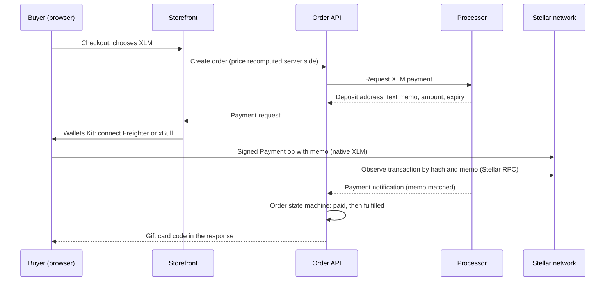
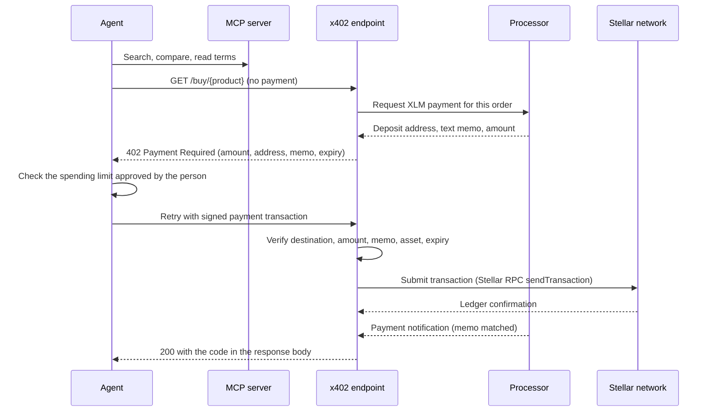

# Genghis on Stellar: technical architecture

Version 1, September 2026. Scope: the Stellar payment path for people, and the x402 payment path for AI agents, on top of a marketplace that is already live. Everything below is what we will build under the Build Award, and how the pieces connect to Stellar.

## 1. What exists and what we add

Genghis is a live marketplace for digital goods: gift cards, game keys, eSIMs and mobile top-ups, paid in crypto. Payment today runs through a licensed processor that issues deposit details per payment (an address, plus a memo on networks that need one) and notifies us when funds arrive. We hold no customer funds and we do not receive payments on company wallets. This stays true after the build.

| Component | Status | Change under this award |
|---|---|---|
| Storefront (Angular, server-side rendered) | Live | Stellar Wallets Kit added to the checkout |
| Order API (NestJS) and order state machine | Live | Stellar payment path, memo attribution, synchronous delivery |
| Catalogue and pricing service | Live | None |
| Read-only MCP server for agents | Built and tested against production | None; agents keep discovering products through it |
| Payment processor integration | Live for other assets | Stellar XLM path added |
| x402 endpoint for agents | Not built | New: the bridge described in section 4 |

## 2. Constraint that shapes the design

Our processor identifies a deposit by two things: the deposit address and a text memo. On Stellar it issues one shared XLM deposit address, so the memo is the only way to tell payments apart. It does not accept muxed (M...) addresses and it does not offer one address per payment. We confirmed this with the processor in September 2026.

A standard x402 payment on Stellar is a Soroban token transfer with signed authorization entries. A transaction that invokes a Soroban contract cannot carry a transaction memo. So a standard x402 payment sent to the processor's shared address cannot be attributed to an order.

This gap affects any Stellar merchant that settles through a memo-based processor or exchange. Closing it is the core technical contribution of this build.

## 3. Flow A: a person pays from a wallet

Stellar details:
- Asset: native XLM. Network passphrase for mainnet or testnet is set per environment.
- Transaction: one Payment operation to the processor's deposit address, MEMO_TEXT set to the value the processor returned, time bounds set to the quote expiry, standard base fee.
- Wallet connection: Stellar Wallets Kit with the Freighter and xBull modules. The kit signs the transaction XDR. We never see keys.
- Client guard: the checkout refuses to enable the pay button if the memo is missing, because a deposit without its memo cannot be attributed.
- Observation: our order API reads the transaction from Stellar RPC (`getTransaction` by hash, `getEvents` for the destination) so the buyer sees confirmation as soon as the ledger closes.
- Release policy: the default trigger for fulfilment is the processor's confirmed notification, plus an amount check. Whether we may release earlier on our own observation of ledger finality, for small orders under a cap, is decided after we measure the processor's notification delay on Stellar. That measurement is part of deliverable 4.

## 4. Flow B: an agent pays through the x402 memo bridge

How the bridge works:
- The 402 response follows the x402 response shape. The payment requirements name the Stellar network and native XLM, and carry the memo in an extra field.
- The agent signs a classic Payment operation with that memo. The endpoint verifies the signed transaction before it submits it: the destination equals the processor's address, the amount and asset match, the memo matches, the time bounds are valid, and the source account is not one of ours.
- Verification and submission by the endpoint replace the facilitator step for this scheme. Settlement is on Stellar and the funds land at the processor, never on a Genghis wallet.
- Every request is idempotent. A retried request with the same payment identifier returns the same result and never buys twice.

## 5. The x402 memo extension we will propose

We will submit a draft to the public x402 specification repository that adds an optional memo to the Stellar scheme. The draft defines:
- a `memo` field in the payment requirements, text or numeric;
- a scheme variant whose payload is a signed classic Payment operation, so the transaction can carry the memo;
- the facilitator checks: the memo in the transaction equals the memo in the requirements, and the destination equals `payTo`.

Standard clients can then pay memo-based merchants and exchanges without a custom integration. Deliverable 3 ships the draft and the working bridge that proves it. We are paid for submitting it, not for acceptance, because acceptance is not ours to control.

## 6. Order state machine and failure cases

States: created, awaiting payment, payment seen, paid, fulfilled, expired, failed, refund due.

| Case | Behaviour |
|---|---|
| Payment without memo | Refused by the client guard and by the endpoint. If it reaches the processor anyway, it is flagged for manual reconciliation. |
| Underpayment | Order stays open until expiry, then moves to refund due. |
| Overpayment | Order is fulfilled and the difference is flagged. |
| Delivery fails after settlement | Order moves to refund due and the agent receives the failure in the response. |
| Duplicate submission | Idempotency key returns the first result. |
| Expired quote | New quote and a new memo. An old memo is never reused. |

## 7. Guardrails for agent purchases

- The server sets the price. A client cannot propose what it pays.
- Every agent purchase has a per-order cap and a per-session cap, enforced on the server. A request over the cap is refused, not trimmed.
- Payments that cannot be tied to an order are refused, not accepted and reconciled later.
- The purchase path is a separate component with its own credentials. The read-only MCP server holds no credentials and refuses writes.
- The existing per-order anti-money-laundering caps apply to agent orders too.
- No identity data is collected beyond what the law requires.

## 8. Environments

- Testnet: Stellar testnet with a processor stub that returns an address, a text memo and a simulated notification with the same fields as the live processor. The processor has no Stellar testnet, so the stub stands in for it.
- Staging: the same code on our staging environment against testnet.
- Mainnet: the real processor with native XLM.
- Scaffold Stellar and the Stellar Lab are used to prototype transactions before they enter the order API.

## 9. Mapping to deliverables

| Deliverable | Architecture parts |
|---|---|
| 1. Stellar payment path in the order API | Sections 3 and 6 |
| 2. Checkout with Stellar Wallets Kit | Section 3, client side |
| 3. Agent payment bridge design and memo extension | Sections 4 and 5 |
| 4. Synchronous confirmation and delivery | Section 3, observation and release policy |
| 5. x402 endpoint through the memo bridge, first agent purchases | Sections 4 and 8 |
| 6. Threat model, monitoring, guardrails | Section 7 |
| 7. Mainnet launch | Section 8 |
| 8. Integration tests and hardening | Section 6 |
| 9. Open source bridge and playbooks | Sections 4 and 5 |

## 10. Open technical risks

- The processor's notification delay on Stellar is unmeasured. We measure it before we publish any speed claim.
- The memo extension needs agreement from facilitator maintainers. The bridge works without it, so the delivery does not depend on acceptance.
- Only native XLM is supported by the processor on Stellar today. USDC on Stellar is not available to us for now.
- Agents that speak only the standard exact scheme cannot pay the bridge until the extension is adopted. They keep discovering and pricing through the MCP server, and pay through our client library.

## References

- Stellar Wallets Kit: https://stellarwalletskit.dev/
- Stellar Lab: https://lab.stellar.org/
- x402 on Stellar: https://developers.stellar.org/docs/build/agentic-payments/x402/quickstart-guide
- x402 specification: https://github.com/x402-foundation/x402
- CAP-67, unified events and muxed addresses in contract transfers: https://github.com/stellar/stellar-protocol/blob/master/core/cap-0067.md
